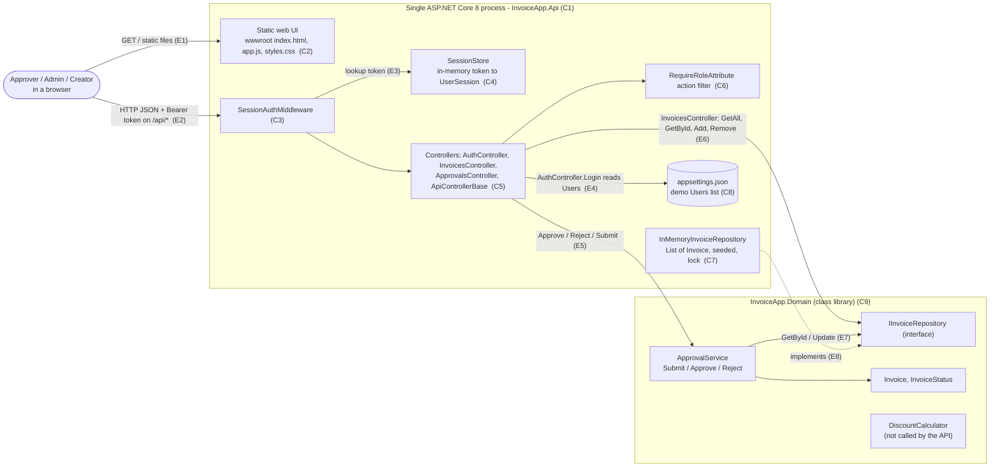
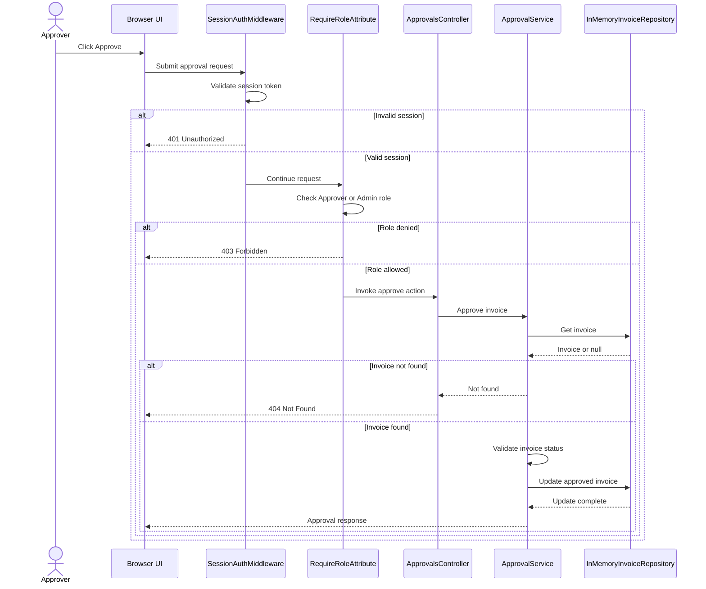
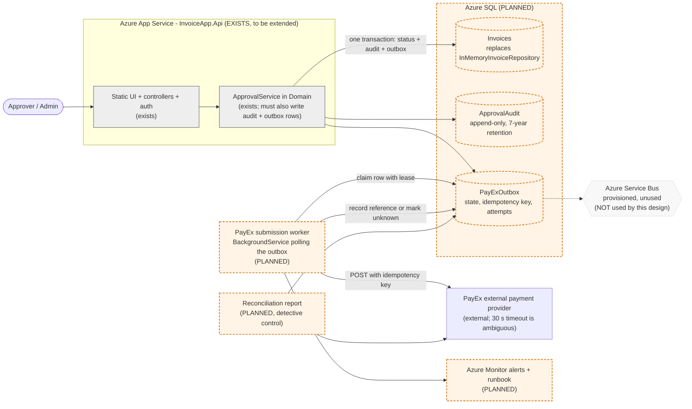

# Deliverable 1 - As-built and target architecture

Tooling note: the assignment asks for the Mermaid MCP. No Mermaid MCP server was available in this
environment (`.mcp.json` only configures Playwright). The Mermaid below was written by hand by the AI assistant
from reading the source, so it is *not* tool-generated. See `07-ai-augmentation-log.md`.

Rule used: every box and arrow in the as-built diagrams cites a file and symbol (citation list in section 3).
Anything the agent assumed rather than read is in section 4 and is not presented as fact.

## 1. As-built container view



Not present in the code, and therefore not drawn: database, message topic / Service Bus, PayEx client,
notification worker, health endpoint, Dockerfile, audit log, HTTPS configuration.

## 2. As-built sequence: approving an invoice



Nothing happens after `Update`: no audit write, no notification, no payment submission. That is the central
gap the target state has to fill.

## 3. Citation list

| ID | Element | Evidence |
|---|---|---|
| C1 | One process hosting UI + API | `backend/src/InvoiceApp.Api/Program.cs`: `WebApplication.CreateBuilder`, `UseDefaultFiles`, `UseStaticFiles`, `MapControllers`; `Properties/launchSettings.json` (`applicationUrl` http://localhost:5000) |
| C2 | Static UI | `backend/src/InvoiceApp.Api/wwwroot/{index.html,app.js,styles.css}`; token kept in `sessionStorage` (`app.js` `sessionStorage.setItem('session', ...)`) |
| C3 | Auth middleware | `Auth/SessionAuthMiddleware.cs` `InvokeAsync`: protects `/api` except `/api/auth/login`; 401 when no session |
| C4 | Session store | `Auth/SessionStore.cs`: `ConcurrentDictionary<string, UserSession>`, `Create` (16 random bytes, hex), `Get`, `Remove` |
| C5 | Controllers | `Controllers/ApiControllerBase.cs` (`Handle`), `AuthController.cs`, `InvoicesController.cs`, `ApprovalsController.cs` |
| C6 | Role filter | `Auth/RequireRoleAttribute.cs` `OnActionExecuting` returns 403; used at class level on `ApprovalsController` (Approver, Admin) and on `InvoicesController.Delete` (Admin) |
| C7 | Repository | `InMemoryInvoiceRepository.cs`: `List<Invoice>` seeded INV-1001..1005, `lock`; registered `AddSingleton<IInvoiceRepository, InMemoryInvoiceRepository>` (`Program.cs:14`) |
| C8 | Demo users | `appsettings.json` `Users`; bound by `builder.Services.Configure<DemoUsersOptions>` (`Program.cs:12`); read in `AuthController.Login` |
| C9 | Domain library | `InvoiceApp.Domain/*.cs`; `InvoiceApp.Domain.csproj` has no package or project references |
| E1 | UI served by API | `Program.cs` `UseDefaultFiles` / `UseStaticFiles` |
| E2 | Bearer token on every /api call | `app.js` `fetch('/api' + path)` with `headers.Authorization`; `SessionAuthMiddleware.BearerPrefix` |
| E3 | Token lookup | `SessionAuthMiddleware` calls `SessionStore.Get` |
| E4 | Login against config | `AuthController.Login`: `_options.Users.FirstOrDefault(...)` (plain-text compare) |
| E5 | Controller to service | `ApprovalsController.Approve/Reject`, `InvoicesController.Submit` -> `ApprovalService`; `Program.cs:15` `AddScoped<ApprovalService>` |
| E6 | Controller to repository (bypasses the service) | `InvoicesController` field `_repository`: `GetAll`, `GetById`, `Create` (`Add`), `Delete` (`Remove`) |
| E7 | Service to repository | `ApprovalService.Find` -> `GetById`; `Submit/Approve/Reject` -> `Update` |
| E8 | Implementation | `InMemoryInvoiceRepository : IInvoiceRepository` |
| S1-S7 | Sequence steps | `app.js` (`decide('/approvals/${invoice.id}/approve')`), `SessionAuthMiddleware.InvokeAsync`, `RequireRoleAttribute.OnActionExecuting`, `ApprovalsController.Approve` (lines 21-23), `ApiControllerBase.Handle` (line 9), `ApprovalService.Approve` (line 31), `ApprovalService.EnsurePending` (line 65) |

## 4. Inferred items (assumed, not verified in code)

1. One instance only. The code is single-process by construction, but the repo does not state a production
   topology. "Three instances behind a load balancer" in INC-2041 is planned state.
2. Sessions are never evicted: `SessionStore` has no expiry code. Inferred from absence.
3. Unauthenticated calls get 401 from the middleware before `RequireRoleAttribute` runs; a wrong role gets
   403. Established by reading, not by running requests.
4. `ApprovalService` is registered `Scoped` but holds no state; the singleton repository carries all state.
   Approve is check-then-act on a shared mutable `Invoice` (`Find`, `EnsurePending`, `Update`), so two
   concurrent approvals are not guaranteed to be serialized. Inferred from reading, not tested.
5. `DiscountCalculator` is unused by the API, inferred from finding no call sites under `backend/src`.
6. Anything beyond `localhost:5000` (TLS, reverse proxy, App Service) is not in the repository.

## 5. Corrections (claims that are wrong against the code)

| Claim | Where it appears | Reality |
|---|---|---|
| Database, Service Bus, notification worker and PayEx exist | `ops/README.md` scenario, INC-2041/2047 packs | None exist. `ops/README.md` itself says they are planned. No `PayExClient`, no worker, no SQL or messaging packages. |
| A `/health` endpoint and a Dockerfile exist | `ops/pipeline/ci-pipeline.yml` (`wait-on .../health`, `docker build`) | Neither exists. The real workflow is `.github/workflows/ci.yml` (build + test only). |
| `CurrentUser`, `DecisionResponse`, `_queries`, `_logger` in controllers | `ops/evals/cases/*.diff`, INC-2041 diff | Do not exist in this tree. Real controllers use `HttpContext.GetSession()` and return `Invoice`. The eval diffs describe a variant of the code. |
| "Controllers use `Handle(...)`" | `AGENTS.md` | True for approve/reject/submit; `InvoicesController.Create` and `Delete` do not use it. |
| "Business rules go in Domain, never in controllers" | `AGENTS.md` | `InvoicesController.Create` validates name/amount and `GetAll` parses the status filter. A small existing violation. |
| "decided as a whole by a single approver" | `ApprovalService` class comment | No rule stops the creator approving their own invoice, and Admin can also approve. |

## 6. Target state (planned; nothing here is built)

Legend: grey = exists today; dashed orange = does NOT exist yet; dotted = provisioned but unused.



The design choice behind this view is argued in `02-exactly-once-decision-record.md`.

## 7. The architecture test

- File: `backend/tests/InvoiceApp.Tests/DomainArchitectureTests.cs`
- Rule (from `AGENTS.md`): `InvoiceApp.Domain` holds business rules only, with no web, storage or messaging
  code and no dependency on `InvoiceApp.Api`. The test fails if the Domain assembly references
  `InvoiceApp.Api`, `Microsoft.AspNetCore*`, `Microsoft.EntityFrameworkCore*`, `Microsoft.Data.SqlClient`,
  `System.Data.SqlClient`, `Azure.Messaging.ServiceBus` or `System.Net.Http`.
- Why this rule: the target state adds SQL, Service Bus and an HTTP client. It is the rule most likely to break
  first (for example by calling PayEx from `ApprovalService`), and INC-2041 is that kind of drift.
- Command:

```
dotnet test backend/InvoiceApp.sln --filter "FullyQualifiedName~DomainArchitectureTests"
```

- Evidence it runs and can fail (2026-10-24, .NET SDK 8.0.426):
  - Clean tree: `Passed! - Failed: 0, Passed: 1`; full suite 8 passed (7 before).
  - Mutation check: temporarily adding `Domain/Mutant.cs` that uses `System.Net.Http.HttpClient` made it fail
    with `InvoiceApp.Domain must not reference web, storage or messaging assemblies, but references:
    System.Net.Http`. The mutant file was then deleted.
- Limit: it inspects assembly references of the compiled Domain assembly, so a forbidden namespace that the
  compiler never needs to reference is not caught.
